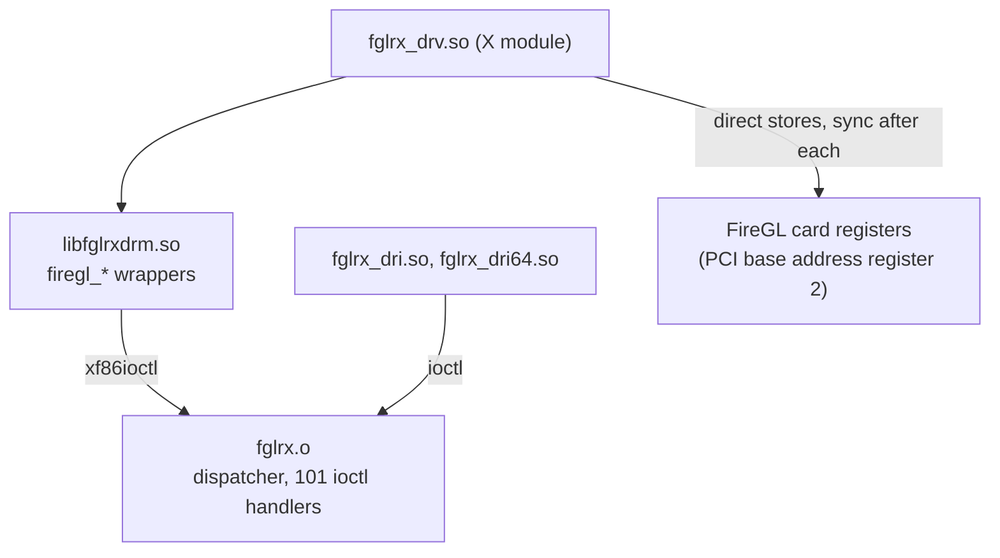

# The FireGL DRM helper library: one entry per routine

`usr/X11R6/lib/modules/irix/libfglrxdrm.so` is an N32 shared object, 31128 bytes, that the X server loads beside the FireGL video driver. Its `.dynsym` table exports the `firegl_*` routines and imports `drmMap`, `drmUnmap`, `drmMalloc`, `drmFree`, `sginap` and the server's `xf86` helpers (`xf86ioctl`, `xf86errno`, `xf86memset`, `xf86strncpy`, `xf86fprintf`, `xf86stderr`, `xf86exit`). It has `.debug_info` and `.debug_funcnames` sections that name routines the dynamic table does not export, and no `.symtab` and no `.mdebug`. Each entry gives a routine, its size and address, and how it uses its arguments and leaves.

Addresses are virtual addresses in the file. A global symbol's GOT slot is local_gotno 25 plus its dynamic symbol index minus the first-global index 73: `xf86errno` is slot 28 (gp-32640), `xf86ioctl` slot 29 (gp-32636), `drmFree` slot 26, `drmMalloc` slot 27, `sginap` slot 31, `xf86memset` slot 34 and `firegl_PM4Alloc` slot 37. The ioctl wrappers return a negated error, with the exceptions noted in their entries: after a failed `xf86ioctl` they load the word that the `xf86errno` slot points to and negate it. Rejected arguments return -1007 and a failed `drmMalloc` returns -1014. The routines below that are not exported are static; the ones that use `gp` without setting it up (`__fglQSQuietDown`, `__fglDRMPM4Alloc`, `__fglDRMPM4Submit`, `__fglDRMPM4Queue`) run with the caller's `gp`.

The command-ring routines share three records. The control record, the first argument (a0) of the ring routines, holds the register aperture pointer as the word at +4, a ring-state pointer as the word at +8, the ring base address as the word at +12 and a second pointer as the word at +16. The ring state holds the write index as the word at +4, the ring size in words at +8, an alignment mask at +16, a free-word count at +20 and the last word written at +24. The second record has the engine's read index as the word at +512. A register offset below is a byte offset into the aperture; its public name beside it comes from the Linux and X.Org register headers.

## The command ring: allocate, queue, submit and wait

- `__fglDRMPM4Queue` (`usr/X11R6/lib/modules/irix/libfglrxdrm.so`, 488 bytes at address 0x403400): closes off the packet the caller just wrote to the ring, waits until the engine has caught up to the start of it, moves the write index past it and writes a four-word trailer after the new end.
  The first argument (a0) is the control record and the second (a1) is the address just past the last word the caller wrote. A zero a1 returns at once (branch at 0x403438) with no stores.
  Padding: while the word index a1 >> 2, ANDed with the alignment mask, is nonzero it stores 0x80000000 at that word and steps to the next (loop 0x403450 to 0x40347c); an a1 that already passes the test pads nothing. The count of padded words is kept in s0.
  Wait: it reads the second record's read index (word at +512) and compares it with the write index [S+4]. If they differ it polls up to 0x10000000 times (loop 0x403498 to 0x4034c4). If the polls run out and the index still differs, it calls `sginap` with 0 once per pass (call at 0x40359c), up to 0x10000000 passes, comparing after each. When those also run out it calls `xf86fprintf` (call at 0x4035d4) with the stream `xf86stderr` points to and the `.rodata` text at 0x404000, "WARNING: FGLRX Submit buffer timed out .." and a newline, and carries on.
  Update: the new end is a1 plus 4 times the padded count. The word at ring state +24 receives the word just before the new end (the last padding word, or the caller's own last word when nothing was padded); the write index becomes the signed word distance from the ring base (the word at a0+12) to the new end; the free count falls by the number of words the index advanced. Store order: +24, +4, +20.
  Trailer: when the new free count is not below 4 (unsigned) it stores at the new end, in this order, 0xbeefdead at +8, 0xdeadbeef at +4, 0x80000000 at +12 and 0x1057c at +0. The write index does not count these four words.
  It sets no return value; both exits (0x403548 and 0x403568) leave v0 unchanged. **Established.**
- `__fglQSQuietDown` (`usr/X11R6/lib/modules/irix/libfglrxdrm.so`, 244 bytes at address 0x403280): waits for the engine's busy bit to clear and tells the caller whether it did.
  The first argument (a0) is the register aperture; the routine tests bit 31 (0x80000000, the public `GUI_ACTIVE` bit) of the word at offset 3648 (0xe40, the public `RBBM_STATUS`) and returns 0 at once when it is clear.
  Otherwise it reads the word up to 2000000 (0x1e8480) times, returning 0 the first time the bit is clear. After that it runs 200 rounds, each one a read of the word and, when the bit is still set, a call to `sginap` with 0 (call at 0x4032f0) followed by adding 10000 to a counter; a clear bit returns 0 and the 200th failed round returns 1 (exit 0x403320).
  It stores nothing but its saved registers. **Established.**
- `__fglDRMPM4Alloc` (`usr/X11R6/lib/modules/irix/libfglrxdrm.so`, 104 bytes at address 0x403380): hands back the address in the ring where the caller can write a requested number of words, when no wrap or wait is needed.
  The first argument (a0) is the control record and the second (a1) the word count. A count that is zero or negative returns 0 (branch at 0x403384).
  With S the ring state, it rounds the count up as (a1 + [S+16] + 2) with the bits of [S+16] cleared, then compares. When the write index [S+4] plus that rounded count is below the ring size [S+8] (unsigned) and the free count [S+20] is not below the rounded count (unsigned), it returns [a0+12] plus 4 times [S+4], with no store.
  In every other case it tail-calls `firegl_PM4Alloc` (GOT slot 37, `jr` at 0x4033d8) with a0 and a1 unchanged. **Established.**
- `__fglDRMPM4Submit` (`usr/X11R6/lib/modules/irix/libfglrxdrm.so`, 72 bytes at address 0x403600): queues the finished packet and then tells the engine where the ring now ends.
  The first argument (a0) is the control record, kept in s8, and a1 passes through untouched. It calls `__fglDRMPM4Queue` (a `bgezall` with the zero register at 0x403618, target 0x403400 formed from the local GOT slot 1).
  Afterwards it reads the ring state S from the word at a0+8 and the aperture from the word at a0+4, stores the write index [S+4] to aperture offset 1812 (0x714, the public `CP_RB_WPTR`) and runs two `sync` instructions (0x403634, 0x403638).
  It returns S, the word at a0+8, which it loaded at 0x403624 (exit at 0x403640). **Established.**
- `firegl_PM4Alloc` (`usr/X11R6/lib/modules/irix/libfglrxdrm.so`, 992 bytes at address 0x403680): returns the ring address for a requested number of words, wrapping the ring and waiting for the engine to free space when needed.
  The first argument (a0) is the control record and the second (a1) the word count. With S the ring state and Z the record at a0+16, the count is rounded up to (a1 + [S+16] + 2) with the bits of [S+16] cleared. The address returned is [a0+12] plus 4 times [S+4], read after any wrap.
  Fits: when [S+4] plus the rounded count is below [S+8] (unsigned) it goes straight to the free-space test.
  Wrap: otherwise it spins without a limit while [S+4] is below the read index [Z+512]. It then fills the words from the write address to the end of the ring with packet headers. It stores the header 0xfffd1000 once per 16383 words (stride 65532 bytes), a number of times equal to (remaining words - 3) / 16383 in signed arithmetic: first that number AND 7 one at a time, then the rest in a loop unrolled eight times that leaves early when the words left drop below 16384 (0x403848, 0x4038a0). The last header has a count field of what is left of (remaining words - 2) after 16383 per full header, shifted left 16 and ORed with 0xc0001000; it goes to the word that follows the full ones and is also stored at [S+24]. A short remainder, below 16386 words, skips the full headers. The multiplication by 0x80020009 with a shift of 13 is the division by 16383. The pattern 0xc0001000 with a count in bits 16 to 29 matches the public Radeon type-3 no-operation packet header, and 16381 in the count field of 0xfffd1000 spans exactly 16383 words, so the fills read as no-operation packets that pad to the end of the ring. That reading comes from the public packet format; the stores themselves are as stated.
  Then it waits for the read index [Z+512] to equal [S+4], polling up to 0x10000000 times, then calling `sginap` with 0 per pass (call at 0x403a1c) for up to 0x10000000 passes; when both run out it calls `xf86fprintf` (call at 0x403a50) with the stream `xf86stderr` points to and the text at 0x404030, "WARNING: FGLRX Submit buffer timed out". It stores 0 at [S+4], 0 at aperture offset 1812 (0x714) followed by a `sync`, and 0 at [S+20], and continues with the ring base as the address.
  Free space: it computes the free count as [Z+512] - [S+4] - 1 when [S+4] is below [Z+512], and as [S+8] - ([S+4] - [Z+512]) - 1 otherwise, stores it at [S+20], and re-reads and recomputes in a loop until the free count is not below the rounded count, with no limit and no `sginap`. Its single exit is at 0x4039a0. **Established.**
- `firegl_PM4WaitForIdle` (`usr/X11R6/lib/modules/irix/libfglrxdrm.so`, 552 bytes at address 0x403a80): queues a cache-flush and wait-for-idle packet, waits for the engine to consume the ring, and then quiets the engine.
  The first argument (a0) is the control record, kept in s6. It loads the second record Z from a0+16 (s1) and the ring state S from a0+8 (s3).
  Packet: it calls `__fglDRMPM4Alloc` (a `bgezall` at 0x403abc, target 0x403380) with a1 = 4 and stores into the returned address, in this order, 1480 (0x5c8) at +8, 0x70000 at +12, 15 at +4 and 3339 (0xd0b) at +0. It then calls `__fglDRMPM4Submit` (a `bgezall` at 0x403afc, target 0x403600) with a0 unchanged and a1 the returned address plus 16, which is the end of the four words. The header 0xd0b, times 4, is register offset 0x342c, the public `RB2D_DSTCACHE_CTLSTAT`, written with 15; 0x5c8, times 4, is offset 0x1720, the public `WAIT_UNTIL`, written with 0x70000, the three public idle-clean bits (16, 17 and 18). That reading comes from the public type-0 packet format.
  Wait: it compares the read index at Z+512 with the write index at S+4 and finishes at once when they are equal. Otherwise it reads Z+512 up to 2000000 (0x1e8480) times. After that it loops: one `sginap` call with 0 (call at 0x403b48), add 10 to a counter that starts at 10, and return 1 (exit 0x403c6c) when the counter passes 16000000 (0xf42400); the loop ends when the read index equals the write index re-read from S+4.
  After the wait: it calls `__fglQSQuietDown` (a `bgezall` at 0x403bc0, target 0x403280) with the aperture, the word at a0+4. When the word at S+56 is zero it stores 1 there and keeps the aperture word at offset 304 (0x130) at S+60; it then writes the word at S+60 back to offset 304, runs `sync`, stores the ring size [S+8] into the free count [S+20], ORs 15 into the aperture word at offset 13356 (0x342c), runs `sync` and calls `__fglQSQuietDown` again (at 0x403c18).
  It returns 0 (exit 0x403c38) after the second quiet-down, or 1 on the timeout; the first quiet-down's result is not used. **Established.**
- `firegl_DRMPoll` (`usr/X11R6/lib/modules/irix/libfglrxdrm.so`, 312 bytes at address 0x403cc0): scans a ring of 20-byte slots for one whose lock word it can take and whose stamp the engine has already passed, and returns that slot.
  The first argument (a0) is the pool record and the second (a1) is the value written into a lock word. The word at a0+20 points to the slot table T, whose first word is the slot count N; slot i lives at T+4+20*i and holds a pointer to a lock word at +0 and a pointer to a doubleword stamp at +4. The word at a0+16 points to a record Z whose words at +8 and +12 form the current stamp. A static word at 0x40419c in `.sbss` holds the slot where the last scan stopped, plus one.
  It returns 0 (0x403dec) when N + C - 1 is not above C + 1, with C that static word, so a table of two slots or fewer is never scanned. Otherwise it visits indexes C + 1 up to C + N - 2, reducing each modulo N (`divu` at 0x403d50; the `teq` at 0x403d94 traps on a zero count).
  For each slot it takes the lock word with a load-linked and store-conditional pair (ll at 0x403d74, sc at 0x403d84, branch-likely retry at 0x403d88): when the word holds zero it stores a1; when it holds anything else the slot is skipped. Having taken the slot it builds a 64-bit value from the words at Z+8 and Z+12 (stored to sp+0 and sp+4 at 0x403dac and 0x403db0, reloaded with `ld` at 0x403db4) and compares it, signed, with the doubleword the slot's stamp pointer addresses. When Z's value is below the stamp it clears the lock word again with a second ll/sc pair that stores zero (ll at 0x403d0c, sc at 0x403d1c, branch-likely retry at 0x403d20) and moves to the next index.
  When the stamp is not ahead it stores the slot's index modulo N plus one in the static word (the store at 0x403de8, in the delay slot of the return at 0x403de4) and returns the slot address, leaving its lock word set to a1. If no slot qualifies it returns 0 (exit 0x403df0). **Established.**

## Setup, teardown and the handle tables

- `firegl_InitDRM` (`usr/X11R6/lib/modules/irix/libfglrxdrm.so`, 832 bytes at address 0x402c40): validates a mapping request, maps three regions through `drmMap` and builds a record plus a table of buffer slots.
  The first argument (a0) is the request record, kept in s0, and the second (a1) is where the result record goes. It returns -1007 when a0 is null (0x402c5c), when the word at +4 is zero, when the word at +32 is zero or above 256, when the word at +36 is below 16384 or has any of its low 14 bits set, or when a1 is null (0x402ce4).
  It then stores zero through a1 and allocates a 24-byte record H with `drmMalloc` (call at 0x402d0c; null returns -1014), clears it with `xf86memset`, copies the request's words at +0 and +4 into H+0 and H+4, and allocates the table T with `drmMalloc` of 20 times the word at +32, plus 4 (call at 0x402d64; the result goes to H+20 whether or not it is null, and null returns -1014).
  Three `drmMap` calls follow, each passing H+0 as the first argument. The first uses the request's doubleword at +8 with size 0x4000 and writes the address M1 to H+16; H+8 becomes M1 plus 520. The second uses the doubleword at +16 with a size of 4 times the word at M1+528 and writes the address to H+12. The third uses the doubleword at +24 with a size of the word at +32 times the word at +36 and writes the address to a stack word at sp+0.
  Table: on success it stores the count (word at +32) in T+0, then for each index i below that count fills the 20-byte slot at T+4+20*i: slot field 0 is M1 + 4*i + 632, field 4 is M1 + 8*i + 1656, field 8 is the third mapping's address plus i times the request's word at +36, field 12 is that word at +36 itself, and field 16 is the request's word at +44 plus i times the word at +36 (stores in the order 0, 8, 4, 16, 12). It stores H through a1 (delay slot of the jump at 0x402f68) and returns 0.
  A failed map returns the negative value `drmMap` gave. The clean-up that follows a failure, in this order: `drmUnmap` of the stack word sp+0 when nonzero (it is always zero when this code is reached), `drmUnmap` of the address in H+12 with 4 times the word at M1+528 when H+12 is nonzero, `drmUnmap` of the address in H+16 with 16384 when nonzero, `drmFree` of T when nonzero, and `drmFree` of H. A failed table allocation takes the same path with every mapping still zero. **Established.**
- `firegl_TermDRM` (`usr/X11R6/lib/modules/irix/libfglrxdrm.so`, 204 bytes at address 0x402f80): undoes `firegl_InitDRM` by unmapping its three regions and freeing the record and the slot table.
  The argument (a0) is the record H, kept in s0. It returns -1007 at 0x402fc4 when a0 is null or when any of the words at +12, +16 and +20 is zero.
  Its three `drmUnmap` calls, in order: the address at the table's +12 (the first slot's mapped address), whose size is the word at table +0 times the word at table +16 (the unsigned product, low 32 bits, from `multu` and `mflo` at 0x402fdc and 0x402fe8); the address in H+12, sized 4 times the word at M1+528 (M1 being the address in H+16, read before that region is unmapped); and the address in H+16, sized 16384.
  It then calls `drmFree` on the table (the word at H+20) and on H itself, and returns 0 at 0x403044. The sizes and offsets are the ones `firegl_InitDRM` stores. **Established.**
- `firegl_GetKernelInfo` (`usr/X11R6/lib/modules/irix/libfglrxdrm.so`, 436 bytes at address 0x402540): asks the kernel module for a block of fixed fields and an optional text buffer in two requests, and returns them in an allocated record.
  The first argument (a0) is the file descriptor and the second (a1) receives the record pointer. A null a1 returns -1007. Otherwise it allocates a 28-byte record with `drmMalloc` (call at 0x402588); the store of zero through a1 sits in the delay slot of that call (0x40258c), and a null result returns -1014.
  It clears a 36-byte block on the stack with `xf86memset` and calls `xf86ioctl` with request 0xc0246450, an in-and-out request of 36 bytes (call at 0x4025c8). A failure frees the record, frees the buffer when the word at block +4 is nonzero, and returns the negated errno. On success the word at block +8 is a length. When it is nonzero the routine allocates length plus 1 bytes with `drmMalloc` (call at 0x402624), stores the pointer at block +4 whether or not it is null, and a null result sets -1014 and takes the clean-up that frees the record. After a good first call, and a good allocation when one is needed, it issues the same request a second time (call at 0x402654), with the block as the first call left it apart from the new buffer pointer at +4.
  A failed second request frees the record, frees the text buffer when the word at block +4 is nonzero, and returns the negated errno. On success it writes a zero byte at the buffer address plus the length when the buffer pointer is nonzero. It then fills the record with seven words: the buffer pointer (block +4) at record +0 and the block words at +12, +16, +20, +24, +28 and +32 at record +4 to +24, in that order, stores the record address through a1 (delay slot at 0x4026f0) and returns 0. **Established.**
- `firegl_LockPages` (`usr/X11R6/lib/modules/irix/libfglrxdrm.so`, 328 bytes at address 0x402040): asks the kernel module to pin a user range and returns a handle that remembers the request.
  The arguments are a0 the file descriptor, a1 the start address, a2 the length and a3 the place to store the handle pointer. It returns -1007 when a1 or a2 is zero (branches at 0x402054 and 0x402068).
  It allocates a 24-byte handle with `drmMalloc` (call at 0x402078; null returns -1014). With x = a2 + (a1 AND 0x3fff), it computes a page count of x >> 14 plus one when the low 14 bits of x are nonzero, and allocates 4 times that count with `drmMalloc` (call at 0x4020dc); a null result frees the handle (`drmFree` at 0x4020fc) and returns -1014.
  It fills a 20-byte request block with a1 at +4, a2 at +8, the page count at +12 and the table pointer at +16, leaving the word at +0 for the kernel, and calls `xf86ioctl` with request 0xc014644b, in and out, 20 bytes. A failure frees the table and then the handle and returns the negated errno.
  On success the handle receives, in this store order: a2 at +12, a1 at +8, the doubleword from the block word at +0 (zero-extended with `lwu`) at +0, the page count at +16 and the table pointer at +20; the word at +4 is not written. It stores the handle address through a3 (delay slot at 0x402184) and returns 0. **Established.**

## Request wrappers that return an id or a value

- `firegl_AllocBuffer` (`usr/X11R6/lib/modules/irix/libfglrxdrm.so`, 232 bytes at address 0x401540): requests a buffer of one of four kinds and hands back its address and an id.
  Arguments: a0 the descriptor, a1 the kind (0, 1, 2 or 3), a2 the size and a3 where the id goes. A zero size (branch at 0x401568) or any other kind returns -1007 (0x401590). The 24-byte block is stored as a doubleword zero at +0, the kind at +8, the size at +12, zero at +16 and -1 at +20, and the call is `xf86ioctl` with request 0xc0186440 (call at 0x4015c8).
  When the call fails it stores the doubleword -1 through a3 (0x4015e8) and returns 0. When it succeeds it stores the word at block +20 zero-extended as a doubleword through a3 (0x40161c) and returns the doubleword at block +0. **Established.**
- `firegl_AllocCache` (`usr/X11R6/lib/modules/irix/libfglrxdrm.so`, 212 bytes at address 0x401640): asks the kernel module for a cache-type buffer with the request that `firegl_AllocBuffer` uses, accepting a different range of kinds and giving back a 32-bit id.
  Arguments: a0 the descriptor, a1 the kind, a2 the size, a3 where the id goes. A zero size (0x401668) or a kind outside the range 4 to 6 returns -1007. The block layout and the request 0xc0186440 are the ones `firegl_AllocBuffer` uses, with the word -1 at +20.
  A failed call stores the word -1 through a3 (0x4016e0, a 4-byte store, not a doubleword) and returns 0. A good call copies the word at block +20 through a3 (0x401708) and returns the 64-bit value loaded from the start of the block (the `ld` at 0x401710). **Established.**
- `firegl_AllocBufferAtPhysicalAddress` (`usr/X11R6/lib/modules/irix/libfglrxdrm.so`, 192 bytes at address 0x401740): requests a buffer at a caller-chosen physical address, accepting three kinds.
  Arguments: a0 the descriptor, a1 the kind, a2 the size, a3 the address. A zero size (0x401770) or a kind other than 1, 2 or 3 returns -1007. The 24-byte block is the one `firegl_AllocBuffer` builds, except that the word at +20 holds a3 and nothing preloads -1; the request is 0xc0186440 (call at 0x4017cc).
  Unlike `firegl_AllocBuffer`, it takes no pointer for an id: a failed call returns 0 and a good call returns the 64-bit value loaded from the start of the block (the `ld` at 0x4017fc). **Established.**

## Request wrappers that only send a value

- `firegl_LockHardware` (`usr/X11R6/lib/modules/irix/libfglrxdrm.so`, 232 bytes at address 0x401bc0): takes the hardware lock from the kernel module, retrying until the request succeeds and ending the process on three specific errors.
  The block is 8 bytes: a1 is the word at +0 and zero the word at +4. The call is `xf86ioctl` (kept in s4) with request 0x8008642a, in only, 8 bytes, and a0 held in s1 (call at 0x401c04). A zero result returns 0 at 0x401c8c.
  On a nonzero result it reads errno and compares it with 1007, 1014 and 1023 (s3, s5, s6). Any of those calls `xf86exit` (call at 0x401c98) with the negated errno in a0, set in the delay slot at 0x401c9c; the code after the call repeats the request, so a return from `xf86exit` would not leave the loop. Any other errno repeats the request at once (call at 0x401c58) and tests errno again after each failed repeat, with no limit and no `sginap`.
  The value returned is the zero that the last `xf86ioctl` returned. **Established.**
- `firegl_VerifyArea` (`usr/X11R6/lib/modules/irix/libfglrxdrm.so`, 156 bytes at address 0x402700): asks the kernel module to check a memory area, and stops asking for good once the kernel answers with the one error that means it does not support the request.
  The arguments are a0 the file descriptor, a1 a 64-bit value stored at +0 of a 16-byte block on the stack, a2 a word stored at +8 and a3 a word stored at +12; the request is `xf86ioctl` with 0x80106451, in only, 16 bytes (call at 0x402740).
  A static word in `.sdata` at 0x404198, whose initial value in the file is 1, is read at 0x402714 through gp-32588. When it is zero the routine returns 0 at 0x402788 without making any request.
  A failed request reads errno. Errno 1007 stores zero in the static word (0x402790) and returns 0, since the branch at 0x402794 reaches the negation with a0 cleared in its delay slot at 0x402798. Any other errno returns the negated value. A good request returns 0 (exit 0x40276c). **Established.**
- `firegl_FreeBufferAdvanced` (`usr/X11R6/lib/modules/irix/libfglrxdrm.so`, 144 bytes at address 0x401880): releases a buffer with the request `firegl_FreeBuffer` uses, and lets the caller ignore one error.
  The arguments are a0 the file descriptor, a1 the buffer id and a2 a flag word. The id is cut to its low 32 bits (`sll` at 0x401894, then `dsll32` and `dsrl32`) and stored with `sd` (0x4018b4) at the start of the block; a2 is saved at sp+24, which is past the end of the 24-byte block that the request size 0x18 names, and the other two doublewords of the block are not written. The request is `xf86ioctl` with 0x80186441, in only, 24 bytes (call at 0x4018b8).
  A good request returns 0 (exit 0x401908). A failed one reads errno: when it is 1022 and bit 0 of a2 is set, the result is 0, otherwise the negated errno (both leave at exit 0x4018f4; the `andi` for the flag sits in the delay slot of the compare at 0x4018dc). **Established.**
- `firegl_GetMemInfo` (`usr/X11R6/lib/modules/irix/libfglrxdrm.so`, 140 bytes at address 0x401480): clears the caller's 32-byte block and asks the kernel module to fill it with memory information.
  The first argument (a0, kept in s8) is the descriptor and the second (a1, saved at sp+16) is the block. It calls `xf86memset` (call at 0x4014b0) with the block, the value 0 and the size 32, then `xf86ioctl` (call at 0x4014c8) with request 0xc0206456, in and out, 32 bytes, passing the block itself.
  It returns 0 on success (exit 0x401504) and the negated errno on failure (exit 0x4014ec). **Established.**
- `firegl_ModuleParm` (`usr/X11R6/lib/modules/irix/libfglrxdrm.so`, 140 bytes at address 0x402380): sends a text parameter, at most 255 characters, to the kernel module.
  The arguments are a0 the descriptor, saved at sp+256, and a1 the string. A null a1 returns -1007 (exit 0x4023f4, with the value set at 0x402388 before the test at 0x402398). Otherwise it calls `xf86strncpy` (call at 0x4023ac) with a 256-byte stack buffer as destination, a1 as source and the count 256, writes a zero byte at buffer offset 255 (0x4023c4) and calls `xf86ioctl` (call at 0x4023c8) with request 0x8000644e and the buffer as the third argument. The size field of that request word is zero although a 256-byte buffer is passed.
  A good request returns 0 (exit 0x402404); a failed one returns the negated errno (exit 0x4023e8). **Established.**
- `firegl_QueryHwCaps` (`usr/X11R6/lib/modules/irix/libfglrxdrm.so`, 140 bytes at address 0x402b80): clears the caller's 16-byte block and asks the kernel module to fill it with hardware capability words.
  The arguments are a0 the descriptor (kept in s8) and a1 the block (saved at sp+16). It calls `xf86memset` (call at 0x402bb0) with the block, 0 and 16, then `xf86ioctl` (call at 0x402bc8) with request 0x40106454, out, 16 bytes, passing the block. It returns 0 on success (exit 0x402c04) and the negated errno on failure (exit 0x402bec). **Established.**
- `firegl_UnlockPages` (`usr/X11R6/lib/modules/irix/libfglrxdrm.so`, 136 bytes at address 0x4021c0): releases the pages a handle from `firegl_LockPages` stands for, then frees the handle.
  The arguments are a0 the descriptor and a1 the handle. The low 32 bits of the doubleword at handle +0 (loaded with `ld` at 0x4021d8, stored with `sw` at 0x4021dc) go to the first word of a block on the stack, and `xf86ioctl` is called (call at 0x4021f0) with request 0x8014644c, in only, 20 bytes; the other words of the block are not written.
  A failed request returns the negated errno (exit 0x402210) and frees nothing. A good one calls `drmFree` (GOT slot 26) on the table pointer at handle +20 (call at 0x402220), then on the handle itself (call at 0x40222c), and returns 0 (exit 0x402240). **Established.**
- `firegl_GetAGPCapPtr` (`usr/X11R6/lib/modules/irix/libfglrxdrm.so`, 132 bytes at address 0x4027c0): returns the first word of an AGP query reply.
  The arguments are a0 the descriptor and a1 where to store the word. A null a1 returns -1007 (exit 0x4027e4). Otherwise the word at +0 of a 12-byte block on the stack is cleared and `xf86ioctl` is called (call at 0x402800) with request 0x400c6452, out, 12 bytes; the other two words are not cleared. A failed request returns the negated errno (exit 0x402820). A good one stores the block word at +0 through a1 (0x402838) and returns 0 (exit 0x40283c). `firegl_GetAGPStatus` and `firegl_GetAGPCommand` make the same request and return the second and third words of the block. **Established.**
- `firegl_GetAGPStatus` (`usr/X11R6/lib/modules/irix/libfglrxdrm.so`, 132 bytes at address 0x402880): returns the second word of the AGP query reply that `firegl_GetAGPCapPtr` reads.
  Same shape as `firegl_GetAGPCapPtr`: a null a1 returns -1007 (exit 0x4028a4); the word at +4 of the 12-byte block is cleared before `xf86ioctl` (call at 0x4028c0, request 0x400c6452, out, 12 bytes); a failure returns the negated errno (exit 0x4028e0). A good request stores the block word at +4 through a1 (0x4028f8) and returns 0 (exit 0x4028fc). **Established.**
- `firegl_GetAGPCommand` (`usr/X11R6/lib/modules/irix/libfglrxdrm.so`, 132 bytes at address 0x402940): returns the third word of the AGP query reply that `firegl_GetAGPCapPtr` reads.
  A null a1 returns -1007 (exit 0x402964); the word at +8 of the 12-byte block is cleared before `xf86ioctl` (call at 0x402980, request 0x400c6452, out, 12 bytes); a failure returns the negated errno (exit 0x4029a0). A good request stores the block word at +8 through a1 (0x4029b8) and returns 0 (exit 0x4029bc). **Established.**
- `firegl_GetLockID` (`usr/X11R6/lib/modules/irix/libfglrxdrm.so`, 116 bytes at address 0x4019c0): asks the kernel module for the lock identifier and stores it.
  The arguments are a0 the descriptor and a1 where the word goes; a1 is not tested for null. A 4-byte block on the stack is cleared and `xf86ioctl` is called (call at 0x4019ec) with request 0x40046457, out, 4 bytes. A failure returns the negated errno (exit 0x401a0c). A good request stores the block word through a1 (0x401a28) and returns 0 (exit 0x401a2c). **Established.**
- `firegl_AllocMutex` (`usr/X11R6/lib/modules/irix/libfglrxdrm.so`, 116 bytes at address 0x401d40): asks the kernel module to create a mutex and stores its id.
  The arguments are a0 the descriptor and a1 where the id goes; a1 is not tested for null. It stores zero through a1 first (0x401d58), clears no stack word, and calls `xf86ioctl` (call at 0x401d6c) with request 0x40046446, out, 4 bytes, and a 4-byte stack block as the argument. A failure returns the negated errno (exit 0x401d8c) with a1 still holding zero. A good request stores the block word through a1 (0x401da8) and returns 0 (exit 0x401dac). **Established.**
- `firegl_SetCapIpcLock` (`usr/X11R6/lib/modules/irix/libfglrxdrm.so`, 112 bytes at address 0x401a40): issues the kernel module's capability request, whose request code sits between the lock-id and restore requests, and hands the reply word back. The name suggests a setter; the code is an out-only read.
  The arguments are a0 the descriptor and a1 where the word goes; a1 is not tested for null and the stack block is not cleared first. `xf86ioctl` is called (call at 0x401a68) with request 0x40046458, out, 4 bytes. A failure returns the negated errno (exit 0x401a88). A good request stores the block word through a1 (0x401aa4) and returns 0 (exit 0x401aa8). The block is read back without any argument having been written into it. **Established.**
- `firegl_modify_ldt` (`usr/X11R6/lib/modules/irix/libfglrxdrm.so`, 108 bytes at address 0x402b00): sends four words to the kernel module and returns the fourth as the kernel leaves it.
  The arguments are a0 the descriptor, a1, a2 and a3. The 16-byte block is filled in the order a3 at +8, -1 at +12, a2 at +4, a1 at +0, and `xf86ioctl` is called (call at 0x402b38) with request 0xc0106455, in and out, 16 bytes. A failure returns -1 (exit 0x402b50), not the errno. A good request returns the block word at +12 (the load at 0x402b5c, exit 0x402b64), which is -1 unless the kernel overwrote it. **Established.**
- `firegl_ModifyBuffer` (`usr/X11R6/lib/modules/irix/libfglrxdrm.so`, 104 bytes at address 0x401940): sends a buffer id and one more word to the kernel module.
  The arguments are a0 the descriptor, a1 the buffer id and a2 a word. The id is stored with `sd` at +0 of the block and a2 with `sw` at +8 (0x401958); the word at +12 is not written. `xf86ioctl` is called (call at 0x40196c) with request 0x80106460, in only, 16 bytes. A failure returns the negated errno (exit 0x40198c); a good request returns 0 (exit 0x4019a0). **Established.**
- `firegl_EnableAuthentication` (`usr/X11R6/lib/modules/irix/libfglrxdrm.so`, 104 bytes at address 0x401ec0): switches the kernel module's client authentication check on or off with a one-word request.
  The second argument a1 is not stored as given: `sltu v1,zero,a1` at 0x401ed8 makes it 1 when a1 is nonzero and 0 otherwise, and that flag is the only word of a 4-byte block (store at 0x401ee0). `xf86ioctl` is called (call at 0x401eec) with request 0x8004644a, in only, 4 bytes, and the block address in a2.
  Nothing else is touched. The negated errno leaves at exit 0x401f0c on a failed request and the constant 0 at exit 0x401f20 on a good one. **Established.**
- `firegl_FreeBuffer` (`usr/X11R6/lib/modules/irix/libfglrxdrm.so`, 100 bytes at address 0x401800): releases a buffer by id.
  The argument a1 is stored with `sd` (0x401820) at the start of a block that the request size says is 24 bytes; the other 16 bytes are not written. `xf86ioctl` is called (call at 0x401828) with request 0x80186441, in only, 24 bytes, the request `firegl_FreeBufferAdvanced` uses. A failure returns the negated errno (exit 0x401848); a good request returns 0 (exit 0x40185c). **Established.**
- `firegl_RestoreCap` (`usr/X11R6/lib/modules/irix/libfglrxdrm.so`, 100 bytes at address 0x401ac0): sends one word to the kernel module's capability restore request.
  a1 is stored with `sw` (0x401ae0) as the block word, and `xf86ioctl` is called (call at 0x401ae8) with request 0x80046459, in only, 4 bytes. A failure returns the negated errno (exit 0x401b08); a good request returns 0 (exit 0x401b1c). **Established.**
- `firegl_SetBlockMode` (`usr/X11R6/lib/modules/irix/libfglrxdrm.so`, 100 bytes at address 0x401b40): sends one word, the block mode, to the kernel module.
  a1 is stored with `sw` (0x401b60) as the block word, and `xf86ioctl` is called (call at 0x401b68) with request 0x8004645a, in only, 4 bytes. A failure returns the negated errno (exit 0x401b88); a good request returns 0 (exit 0x401b9c). **Established.**
- `firegl_FreeMutex` (`usr/X11R6/lib/modules/irix/libfglrxdrm.so`, 100 bytes at address 0x401dc0): releases a mutex by id.
  a1 is stored with `sw` (0x401de0) as the block word, and `xf86ioctl` is called (call at 0x401de8) with request 0x80046447, in only, 4 bytes, the counterpart of the out-only request in `firegl_AllocMutex`. A failure returns the negated errno (exit 0x401e08); a good request returns 0 (exit 0x401e1c). **Established.**
- `firegl_RegisterTexture` (`usr/X11R6/lib/modules/irix/libfglrxdrm.so`, 100 bytes at address 0x401f40): registers a texture with the kernel module and returns a word from the block.
  a1 is stored with `sw` (0x401f60) at +0 of an 8-byte block, and `xf86ioctl` is called (call at 0x401f68) with request 0x80086448, in only, 8 bytes. A failure returns the negated errno (exit 0x401f88). A good request returns the block word at +4 (the load at 0x401f94, exit 0x401f9c); the routine never writes that word, so the value is whatever the stack held unless the kernel writes it back. **Established.**
- `firegl_UnregisterTexture` (`usr/X11R6/lib/modules/irix/libfglrxdrm.so`, 100 bytes at address 0x401fc0): tells the kernel module to drop a texture registration.
  a1 is stored with `sw` (0x401fe0) as the only word of the block, and `xf86ioctl` is called (call at 0x401fe8) with request 0x80046449, in only, 4 bytes; `firegl_RegisterTexture` uses the 8-byte request 0x80086448. A failure returns the negated errno (exit 0x402008); a good request returns 0 (exit 0x40201c). **Established.**
- `firegl_RmMap` (`usr/X11R6/lib/modules/irix/libfglrxdrm.so`, 100 bytes at address 0x402440): passes one 64-bit value to the kernel module at the +24 slot of a 40-byte request block.
  The second argument a1 goes in with `sd` at 0x402460, 24 bytes into the 40-byte block at sp+0 that the call receives as its third argument; the other 32 bytes are never written, so the kernel reads whatever the stack held there. The request is 0x8028644f (in only, 40 bytes), issued by the `xf86ioctl` call at 0x402468.
  The frame is 64 bytes, with gp saved at sp+40 and ra at sp+48. A failure returns the negated errno (exit 0x402488); a good request returns 0 (exit 0x4024a0). **Established.**
- `firegl_EnableStereo` (`usr/X11R6/lib/modules/irix/libfglrxdrm.so`, 100 bytes at address 0x403100): sends one word to the kernel module's stereo request.
  a1 is stored with `sw` (0x403120) as the block word, and `xf86ioctl` is called (call at 0x403128) with request 0x80046462, in only, 4 bytes. The word is passed as given, not reduced to 0 or 1. A failure returns the negated errno (exit 0x403148); a good request returns 0 (exit 0x403160). **Established.**
- `firegl_AGPAcquire` (`usr/X11R6/lib/modules/irix/libfglrxdrm.so`, 100 bytes at address 0x403180): sends one word to the kernel module's AGP acquire request.
  a1 is stored with `sw` (0x4031a0) as the block word, and `xf86ioctl` is called (call at 0x4031a8) with request 0x80046463, in only, 4 bytes, one request code above the stereo request. A failure returns the negated errno (exit 0x4031c8); a good request returns 0 (exit 0x4031e0). **Established.**
- `firegl_AgpLockPages` (`usr/X11R6/lib/modules/irix/libfglrxdrm.so`, 96 bytes at address 0x401e40): lets the caller describe a run of AGP pages in its own 104-byte block and hands that block to the kernel module untouched.
  The routine has no stack block of its own (a 16-byte frame holds only gp and ra). The second argument a1 is copied to a2 at 0x401e58 and `xf86ioctl` is called (call at 0x401e64) with request 0x80686445, in only, 104 bytes.
  A failed request returns the negated errno (exit 0x401e88 after the load of errno at 0x401e78); a good one returns 0 (exit 0x401e9c). **Established.**
- `firegl_FlushCache` (`usr/X11R6/lib/modules/irix/libfglrxdrm.so`, 96 bytes at address 0x402280): asks the kernel module to flush the cache.
  `xf86ioctl` is called (call at 0x4022a4) with request 0x2000644d, which carries no data, and a2 set to zero in the delay slot at 0x4022a8. A failure returns the negated errno (exit 0x4022c4); a good request returns 0 (exit 0x4022dc). **Established.**
- `firegl_InitIrq` (`usr/X11R6/lib/modules/irix/libfglrxdrm.so`, 96 bytes at address 0x402300): forwards a caller-built block to the kernel module's interrupt set-up request, which can write the block back.
  The block a1 is moved to a2 (0x402318) and passed unread. `xf86ioctl` is called (call at 0x402324) with request 0xc008645d, in and out, 8 bytes. A failure returns the negated errno (exit 0x402344); a good request returns 0 (exit 0x40235c). **Established.**
- `firegl_InitCP` (`usr/X11R6/lib/modules/irix/libfglrxdrm.so`, 96 bytes at address 0x402a00): hands the caller's 32-byte command-processor description to the kernel module untouched.
  There is no stack block of its own; the 16-byte frame holds gp and ra. The second argument a1 becomes a2 at 0x402a18 and `xf86ioctl` is called (call at 0x402a24) with request 0x80206453, in only, 32 bytes.
  A failed request returns the negated errno (exit 0x402a44); a good request returns 0 (exit 0x402a58). **Established.**
- `firegl_InitUMM` (`usr/X11R6/lib/modules/irix/libfglrxdrm.so`, 96 bytes at address 0x402a80): forwards a caller-built block to the kernel module's memory-manager set-up request.
  The block a1 is moved to a2 (0x402a98) and passed unread. `xf86ioctl` is called (call at 0x402aa4) with request 0x8018645b, in only, 24 bytes. A failure returns the negated errno (exit 0x402ac4); a good request returns 0 (exit 0x402ad8). **Established.**
- `firegl_SyncDacs` (`usr/X11R6/lib/modules/irix/libfglrxdrm.so`, 96 bytes at address 0x403080): issues the kernel module's no-data DAC synchronisation request; the effect is named only by the routine's name.
  `xf86ioctl` is called (call at 0x4030a4) with request 0x20006461, which carries no data, and a2 set to zero in the delay slot at 0x4030a8. A failure returns the negated errno (exit 0x4030c4); a good request returns 0 (exit 0x4030d8). **Established.**
- `firegl_CPResume` (`usr/X11R6/lib/modules/irix/libfglrxdrm.so`, 96 bytes at address 0x403200): issues the kernel module's no-data command-processor resume request; the effect is named only by the routine's name.
  `xf86ioctl` is called (call at 0x403224) with request 0x20006464, which carries no data, and a2 set to zero in the delay slot at 0x403228. A failure returns the negated errno (exit 0x403244); a good request returns 0 (exit 0x403258). **Established.**
- `firegl_FreeKernelInfo` (`usr/X11R6/lib/modules/irix/libfglrxdrm.so`, 88 bytes at address 0x4024c0): frees the record `firegl_GetKernelInfo` returns together with its text buffer.
  The argument a0 is the record, kept in s0. A null a0 jumps to the epilogue at 0x402508 with no call and without setting v0. Otherwise it loads the word at record +0, the text buffer pointer, and when that is nonzero calls `drmFree` on it (call at 0x4024f0); it then calls `drmFree` on the record (call at 0x4024fc, a0 set in the delay slot at 0x402500). The result is whatever `drmFree` leaves in v0 (exit 0x402510). **Established.**
- `firegl_UnlockHardware` (`usr/X11R6/lib/modules/irix/libfglrxdrm.so`, 84 bytes at address 0x401cc0): gives the hardware lock back to the kernel module and ends the process if the kernel refuses.
  a1 is stored with `sw` at +0 of an 8-byte block and zero at +4 (0x401cd8). `xf86ioctl` is called (call at 0x401cec) with request 0x8008642b, in only, 8 bytes, the release counterpart of the 0x8008642a request in `firegl_LockHardware`. A nonzero result calls `xf86exit` (GOT slot 33, call at 0x401cfc) with -1 set in the delay slot at 0x401d00, and there is no errno test. The routine then returns through exit 0x401d0c with whatever v0 holds: the zero of a good request, or what `xf86exit` returned if it returned. **Established.**
- `_stub` (`usr/X11R6/lib/modules/irix/libfglrxdrm.so`, 64 bytes at address 0x4013e0, the start of the `.MIPS.stubs` section): the lazy-binding stubs for three imported routines.
  The section opens with a `break 6` word. Three five-word stubs follow, at 0x4013e4, 0x4013f8 and 0x40140c, each loading the resolver from the first GOT word (gp-32752, the start of the table at 0x4040f4), saving ra in t3, jumping through t9 and setting t8 in the delay slot to the dynamic symbol index: 0x52 for `xf86memset`, 0x53 for `xf86strncpy` and 0x54 for `xf86fprintf`. Those three symbols' `.dynsym` values point at the stubs. **Established.**
- `setup` (`usr/X11R6/lib/modules/irix/libfglrxdrm.so`, 8 bytes at address 0x403e00): returns 1 and does nothing else.
  It is a `jr ra` with `li v0,1` in the delay slot (0x403e04), takes no argument and touches no memory. **Established.**

## Ioctl request numbers and the kernel handlers they reach

Each request below is the word a wrapper passes to `xf86ioctl`. The kernel module's dispatcher takes the command number from the low byte of that word and runs the handler in slot N of its table of 101 handlers, each 16 bytes, at `.data`+0x348 in usr/cpu/sysgen/IP35boot/fglrx.o (software/kernel/kernel-drm-functions.md, `firegl_ioctl`). The slot's address is 0x348 plus 16 times N. A zero handler makes the dispatcher return -22.

<!-- Question: which userland pieces reach the kernel object by ioctl, and which write registers themselves?
     Evidence: software/xsgi/libfglrxdrm-functions.md (imports xf86ioctl; "Ioctl request numbers"), software/opengl/dri-driver.md ("The ioctl wrappers"),
     software/kernel/kernel-attach.md (X module writes its own BAR 2 mapping; 101-handler table in fglrx.o). -->

- `0x2000644d` is sent by `firegl_FlushCache`, a wrapper in usr/X11R6/lib/modules/irix/libfglrxdrm.so, with no payload (call at 0x4022a4).
  Its low byte, 0x4d, is index 77, so the dispatcher runs slot 77 at +0x818.
  That slot holds `firegl_flush_cache`, which calls `__ke_flush_cache` at 0x2032c (evidence/routines/vfin-fglrxo-5.md). **Inferred.**
- `0x20006461` is sent by `firegl_SyncDacs` in usr/X11R6/lib/modules/irix/libfglrxdrm.so, with no payload (call at 0x4030a4).
  The low byte 0x61 gives index 97, the slot at +0x958 of the table in fglrx.o.
  That handler, `firegl_sync_dacs`, restarts both display controllers together (software/kernel/kernel-drm-functions.md). **Inferred.**
- `0x20006464` is sent by `firegl_CPResume` in usr/X11R6/lib/modules/irix/libfglrxdrm.so, with no payload (call at 0x403224).
  Index 100 comes from the low byte 0x64, and the slot is at +0x988 of the table in fglrx.o.
  That handler, `firegl_cp_resume`, calls `__ke_get_file_priv` at 0x17cf0 and then an unnamed routine three times (evidence/routines/vfin-fglrxo-1.md). What that routine does is unknown here.
- `0x40046446` is the out-only request that `firegl_AllocMutex` sends from usr/X11R6/lib/modules/irix/libfglrxdrm.so (call at 0x401d6c).
  The index is 70, from the low byte 0x46, and the slot sits at +0x7a8.
  That handler, `firegl_alloc_mutex`, creates a mutex with `firegl_new_mutex` and copies its identifier back to the caller (software/kernel/kernel-drm-functions.md). **Inferred.**
- `0x40046457` is sent by `firegl_GetLockID` in usr/X11R6/lib/modules/irix/libfglrxdrm.so.
  Its low byte 0x57 selects index 87, the slot at +0x8b8 of the table in fglrx.o.
  That handler, `firegl_get_lockid`, finds the file's private record with `__ke_get_file_priv` at 0x174ac, reads the word at offset 28 of it and copies 4 bytes to the caller (evidence/routines/vfin-fglrxo-0.md). **Inferred.**
- `0x40046458` is sent by `firegl_SetCapIpcLock` in usr/X11R6/lib/modules/irix/libfglrxdrm.so.
  Index 88 comes from the low byte 0x58, and the slot is at +0x8c8.
  That handler, `firegl_set_cap_ipc_lock`, tests capability number 1 with `__ke_capable` at 0x2038c and raises it in the effective set with `__ke_cap_effective_raise` at 0x203f8 (evidence/routines/vfin-fglrxo-0.md). Which branch leads to the raise is unknown. **Inferred.**
- `0x80046447` is the in-only counterpart of `firegl_AllocMutex`, sent as `firegl_FreeMutex` in usr/X11R6/lib/modules/irix/libfglrxdrm.so.
  The low byte 0x47 gives index 71, the slot at +0x7b8 of the table in fglrx.o.
  That handler, `firegl_free_mutex`, removes a mutex identifier from the opening file's list and from the device's table (software/kernel/kernel-drm-functions.md). **Inferred.**
- `0x80046449` is sent by `firegl_UnregisterTexture` in usr/X11R6/lib/modules/irix/libfglrxdrm.so.
  Index 73 comes from the low byte 0x49, and the slot is at +0x7d8 of the table in fglrx.o.
  That handler, `firegl_unregister_texture`, removes one texture identifier from the device's list (software/kernel/kernel-drm-functions.md). **Inferred.**
- `0x8004644a` is sent by `firegl_EnableAuthentication` in usr/X11R6/lib/modules/irix/libfglrxdrm.so.
  The low byte 0x4a gives index 74, the slot at +0x7e8.
  That handler, `firegl_enable_auth`, reads a 4-byte status from user space and sets or clears an authentication flag in the device structure. It returns -14 when the copy fails and 0 otherwise (software/kernel/kernel-drm-functions.md). **Inferred.**
- `0x80046459` is sent by `firegl_RestoreCap` in usr/X11R6/lib/modules/irix/libfglrxdrm.so, the counterpart of `firegl_SetCapIpcLock`.
  Index 89 comes from the low byte 0x59, and the slot sits at +0x8d8.
  That handler, `firegl_restore_cap`, copies 4 bytes from the user pointer with `__ke_copy_from_user` at 0x20430. Only when that copy returns 0 does it set the effective capability set with `__ke_set_cap_effective` at 0x20464 (evidence/routines/vfin-fglrxo-1.md). **Inferred.**
- `0x8008642a` is sent by `firegl_LockHardware` in usr/X11R6/lib/modules/irix/libfglrxdrm.so.
  The low byte 0x2a gives index 42, the slot at +0x5e8 of the table in fglrx.o.
  That handler, `firegl_lock`, validates the requested context and takes the hardware lock for it through `firegl_lock_device` (software/kernel/kernel-drm-functions.md). **Inferred.**
- `0x8008642b` is sent by `firegl_UnlockHardware` in usr/X11R6/lib/modules/irix/libfglrxdrm.so, the release counterpart of the request above.
  Index 43 comes from the low byte 0x2b, and the slot is at +0x5f8.
  That handler, `firegl_unlock`, releases the hardware lock a context holds (software/kernel/kernel-drm-functions.md). **Inferred.**
- `0x80086448` is sent by `firegl_RegisterTexture` in usr/X11R6/lib/modules/irix/libfglrxdrm.so.
  Its low byte 0x48 selects index 72, the slot at +0x7c8 of the table in fglrx.o.
  That handler, `firegl_register_texture`, hands back the identifier of a dead texture record when one is waiting and otherwise registers a new one (software/kernel/kernel-drm-functions.md). **Inferred.**
- `0x80106460` is sent by `firegl_ModifyBuffer` in usr/X11R6/lib/modules/irix/libfglrxdrm.so.
  The index is 96, from the low byte 0x60, and the slot sits at +0x948.
  That handler, `firegl_modify_buf`, looks up one of the file's buffer queues by handle and passes the request's flag word to `modify_buffer` (software/kernel/kernel-drm-functions.md). **Inferred.**
- `0x8014644c` is sent by `firegl_UnlockPages` in usr/X11R6/lib/modules/irix/libfglrxdrm.so.
  Index 76 follows from the low byte 0x4c, and the slot is at +0x808.
  That handler, `firegl_unlock_memory`, releases a locked user-memory record and puts it back on the file's list when the release fails (software/kernel/kernel-drm-functions.md). **Inferred.**
- `0x80186441` is sent by `firegl_FreeBuffer` in usr/X11R6/lib/modules/irix/libfglrxdrm.so, which also has `firegl_FreeBufferAdvanced`.
  The low byte 0x41 gives index 65, the slot at +0x758 of the table in fglrx.o.
  That handler, `firegl_free_bufs`, releases the buffer queue a user handle names, or parks it on the device's dead list while it is still mapped (software/kernel/kernel-drm-functions.md). **Inferred.**
- `0x8018645b` is sent by `firegl_InitUMM` in usr/X11R6/lib/modules/irix/libfglrxdrm.so.
  Index 91 comes from the low byte 0x5b, and the slot sits at +0x8f8.
  That handler, `firegl_umm_init`, sets up the unified memory apertures that the driver hands out of the board's frame buffer (software/kernel/kernel-drm-functions.md). **Inferred.**
- `0x80206453` is sent by `firegl_InitCP` in usr/X11R6/lib/modules/irix/libfglrxdrm.so.
  The low byte 0x53 gives index 83, the slot at +0x878.
  That handler, `firegl_cp_init`, adopts three already-created memory maps, named by handle in a 32-byte argument, as the command-processor structures. It changes no chip register (software/kernel/kernel-drm-functions.md). **Established.**
- `0x8028644f` is sent by `firegl_RmMap` in usr/X11R6/lib/modules/irix/libfglrxdrm.so.
  Index 79 follows from the low byte 0x4f, and the slot is at +0x838.
  That handler, `drm_rmmap`, reads a 40-byte request and asks `firegl_rmmap` to remove the map that one of its fields names (software/kernel/kernel-drm-functions.md). **Inferred.**
- `0xc008645d` is sent by `firegl_InitIrq` in usr/X11R6/lib/modules/irix/libfglrxdrm.so, with a block the caller builds (call at 0x402324).
  Its low byte 0x5d selects index 93, the slot at +0x918 of the table in fglrx.o.
  That handler, `firegl_install_irq`, turns on the ATI layer's interrupt use. It calls `__ke_request_irq` and waits 200 ms between its two halves (software/kernel/kernel-drm-functions.md). **Inferred.**
- `0xc014644b` is sent by `firegl_LockPages` in usr/X11R6/lib/modules/irix/libfglrxdrm.so.
  The index is 75, from the low byte 0x4b, and the slot sits at +0x7f8.
  That handler, `firegl_lock_memory`, locks a range of user pages in memory and writes the physical address of each page back to the caller (software/kernel/kernel-drm-functions.md). **Inferred.**
- `0xc0186440` is sent by `firegl_AllocBuffer` in usr/X11R6/lib/modules/irix/libfglrxdrm.so, which also has `firegl_AllocBufferAtPhysicalAddress`.
  Index 64 comes from the low byte 0x40, and the slot is at +0x748.
  That handler, `firegl_alloc_bufs`, copies a 24-byte request in from user space, creates a buffer queue of the requested kind and returns the queue's mapping handle (software/kernel/kernel-drm-functions.md). **Inferred.**
- `0xc0206456` is sent by `firegl_GetMemInfo` in usr/X11R6/lib/modules/irix/libfglrxdrm.so.
  The low byte 0x56 gives index 86, the slot at +0x8a8 of the table in fglrx.o.
  That handler, `firegl_bufmeminfo`, returns the unified-memory free and total sizes to the caller (software/kernel/kernel-drm-functions.md). **Inferred.**
- `0xc0246450` is sent by `firegl_GetKernelInfo` in usr/X11R6/lib/modules/irix/libfglrxdrm.so.
  The slot for index 80 (low byte 0x50) is at +0x848 of the table in fglrx.o, and it holds 0xff2c, the address of `firegl_kernel_info`.
  That handler reports the running kernel's release string and a few build properties in a 40-byte request (software/kernel/kernel-drm-functions.md). **Inferred.**
- `0x80106451` is sent by `firegl_VerifyArea` in usr/X11R6/lib/modules/irix/libfglrxdrm.so.
  Index 81 comes from the low byte 0x51. Its slot at +0x858 holds 0x10280, the address of `firegl_verify_area`.
  That handler checks whether a user address range may be read or written, as the caller asks. It returns -14 for a failed copy and for any kind other than 0 or 1 (software/kernel/kernel-drm-functions.md). **Inferred.**
- `0x40106454` is sent by `firegl_QueryHwCaps` in usr/X11R6/lib/modules/irix/libfglrxdrm.so.
  The low byte 0x54 selects index 84, and the slot at +0x888 holds 0x10184, the address of `firegl_query_hw_caps`.
  That handler runs the workstation-board check on the device and copies 16 bytes of capability data out of the device structure. It returns 0, -19 or -14 (software/kernel/kernel-drm-functions.md). **Inferred.**
- `0x8004645a` is sent by `firegl_SetBlockMode` in usr/X11R6/lib/modules/irix/libfglrxdrm.so.
  Index 90 comes from the low byte 0x5a. Its slot at +0x8e8 holds 0xfd40, the address of `firegl_set_block_mode`.
  That handler stores the caller's block-mode word in the device record (software/kernel/kernel-drm-functions.md). **Inferred.**
- `0x80046462` is sent by `firegl_EnableStereo` in usr/X11R6/lib/modules/irix/libfglrxdrm.so.
  The low byte 0x62 gives index 98. Its slot at +0x968 holds 0x11064, the address of `firegl_enable_stereo`.
  That handler turns the board's stereo mode on or off for the opening file (software/kernel/kernel-drm-functions.md). **Inferred.**
- `0xc0106455` is sent by `firegl_modify_ldt` in usr/X11R6/lib/modules/irix/libfglrxdrm.so, which sends four words.
  Index 85 comes from the low byte 0x55. Its slot at +0x898 holds 0x10278, a routine in fglrx.o that no kernel doc names.
  What that routine does is unknown here, so its effect is not yet credited.
- `0x400c6452` is sent by `firegl_GetAGPCapPtr` in usr/X11R6/lib/modules/irix/libfglrxdrm.so, with the same word as `firegl_GetAGPCommand` and `firegl_GetAGPStatus`.
  The low byte 0x52 gives index 82, and the table slot at +0x868 holds no handler address.
  A zero handler sends the dispatcher to its "no function" branch, which returns -22 (software/kernel/kernel-drm-functions.md). **Established.**
- `0x8000644e` is sent by `firegl_ModuleParm` in usr/X11R6/lib/modules/irix/libfglrxdrm.so.
  Index 78 comes from the low byte 0x4e, and the slot at +0x828 holds no handler address, so the request returns -22 without reaching a handler. **Established.**
- `0x80046463` is sent by `firegl_AGPAcquire` in usr/X11R6/lib/modules/irix/libfglrxdrm.so (call at 0x4031a8).
  The low byte 0x63 selects index 99, and its slot at +0x978 holds no handler address, so the dispatcher returns -22. **Established.**
- `0x80686445` is sent by `firegl_AgpLockPages` in usr/X11R6/lib/modules/irix/libfglrxdrm.so, with a 104-byte block (call at 0x401e64).
  Index 69 comes from the low byte 0x45, and the slot at +0x798 holds no handler address, so the dispatcher returns -22. **Established.**
